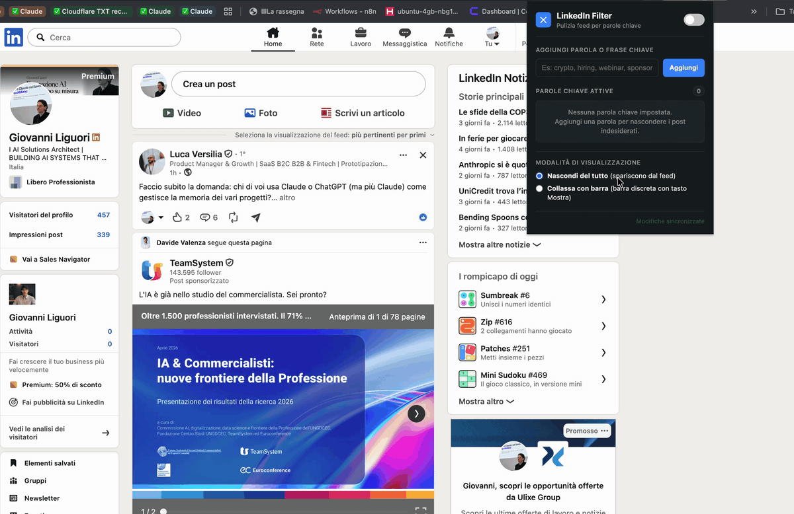

# 🛡️ LinkedIn Feed Keyword Filter

> Clean your LinkedIn feed from noise, buzzwords, and repetitive topics. A lightweight, privacy-first browser extension (Manifest V3) that automatically filters and hides posts based on your custom keywords.

<p align="center">
  
</p>

<p align="center">
  <a href="#why"></a>
  <a href="#-installation"></a>
  <a href="#-installation"></a>
  <a href="LICENSE"></a>
  <a href="#"></a>
</p>

---

## 🎯 Why This Extension?

Your LinkedIn feed is often flooded with content you simply don't want to see:
- Repetitive buzzwords and viral engagement-bait
- Topics you aren't interested in (e.g. crypto, politics, hiring blitzes)
- Sponsored content and self-promotion disguised as advice

**LinkedIn Feed Filter** gives you full control back over what appears on your timeline. Add any keyword or phrase, and matching posts are instantly and smoothly removed.

---

## ✨ Features

- **⚡ Real-time Filtering**: Posts containing your keywords disappear automatically as you scroll down your feed.
- **🔄 Instant Sync**: Change keywords in the popup, and every open LinkedIn tab updates instantly without refreshing.
- **👀 Two Display Modes**:
  - **Hide Completely (*Default*)**: Seamless feed. Posts are completely removed (`display: none`), with no gaps or blank spots.
  - **Collapse with Notice**: Collapses the post into a subtle banner showing which keyword matched, plus a **Show** button if you want to inspect it.
- **🔍 Smart Matching**:
  - Handles single words with boundary detection (so blocking `pro` won't block `programmer`).
  - Handles hashtags (e.g. `#crypto`, `#hiring`).
  - Handles multi-word phrases (e.g. `growth hacking`, `open for work`).
- **🚀 60 FPS Smooth Scroll**: Built with `requestAnimationFrame` debouncing and batching so your browser stays fast and responsive.
- **🔒 100% Private & Open Source**: No remote servers, no analytics, no tracking. Runs entirely inside your browser using the native storage API.

---

## 🛠️ Installation

### 🟦 Google Chrome / Brave / Edge (Chromium-based)

1. **Clone or Download** this repository:
   ```bash
   git clone https://github.com/backpropagation6/linkedin-feed-filter.git
   ```
   *(Or click **Code > Download ZIP** on GitHub and unzip it)*.

2. Open your browser and navigate to:
   ```text
   chrome://extensions/
   ```

3. Toggle **Developer mode** on (top-right corner).

4. Click **Load unpacked** (top-left button).

5. Select the `linkedin-feed-filter` folder.

6. **Done!** Pin the icon to your toolbar for quick access.

---

### 🦊 Firefox (109+)

Firefox supports Manifest V3 natively since version 109. No separate build needed — the same extension works as-is.

1. **Clone or Download** this repository:
   ```bash
   git clone https://github.com/backpropagation6/linkedin-feed-filter.git
   ```

2. Open Firefox and navigate to:
   ```text
   about:debugging#/runtime/this-firefox
   ```

3. Click **Load Temporary Add-on…**

4. Navigate into the `linkedin-feed-filter` folder and select **`manifest.json`**.

5. **Done!** The extension is active for this Firefox session.

> **Note**: Temporary add-ons in Firefox are removed when you close the browser. For a permanent install, the extension needs to be signed by Mozilla. You can submit it to [addons.mozilla.org (AMO)](https://addons.mozilla.org/en-US/developers/) for free distribution and permanent installation.

---

## 💡 How to Use

1. Click the **LinkedIn Filter** icon in your toolbar.
2. Type a word or phrase in the text box (e.g. `webinar`, `crypto`, `hiring`, `AI prompts`) and press **Enter** or click **Aggiungi**.
3. Pick your preferred mode:
   - *Nascondi del tutto* (completely removes matching cards).
   - *Collassa con barra* (shows a discreet placeholder with a toggle).
4. Browse [linkedin.com/feed](https://www.linkedin.com/feed/) — matching posts are filtered immediately!

---

## 📂 Repository Structure

```text
linkedin-feed-filter/
├── assets/
│   └── demo.gif             # Showcase animation
├── icons/                   # Multi-resolution extension icons (16, 48, 128px)
├── content.js               # Feed observer, DOM batching & filtering engine
├── content.css              # Styling for hidden and collapsed post cards
├── popup.html               # Clean, accessible settings popup
├── popup.css                # Dark & light mode UI styling
├── popup.js                 # Keyword management and sync logic
├── manifest.json            # Manifest V3 (Chrome + Firefox compatible)
├── scripts/
│   └── generate_icons.py    # Icon generator utility
└── README.md
```

---

## 🌐 Browser Compatibility

| Browser | Support | Notes |
|---------|---------|-------|
| Chrome 88+ | ✅ Full | Native MV3 |
| Brave | ✅ Full | Chromium-based |
| Edge (Chromium) | ✅ Full | Chromium-based |
| Firefox 109+ | ✅ Full | Native MV3, `browser_specific_settings` included |
| Safari | ❌ Not supported | Requires Safari Web Extension conversion |
| Opera | ✅ Full | Chromium-based |

---

## 🤝 Community & Contributions

This project was built to give the community a clean, ad-free, distraction-free LinkedIn experience.

Contributions, feature requests, and improvements are very welcome:
- Found an unhandled LinkedIn post format? Open an [Issue](https://github.com/backpropagation6/linkedin-feed-filter/issues).
- Want to add a new feature? Feel free to submit a [Pull Request](https://github.com/backpropagation6/linkedin-feed-filter/pulls).

---

## 📄 License

Distributed under the [MIT License](LICENSE). Built for the community with ❤️.
